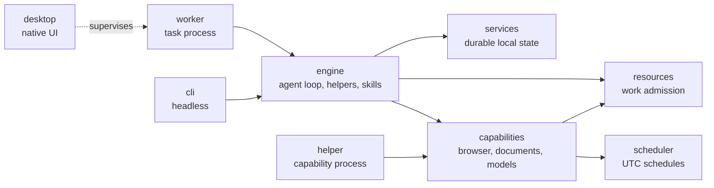

<div align="center">
  <h1>Xylo</h1>
  <h3>Your projects. Your models. One workspace.</h3>
  <p>A native desktop workspace for AI conversations, coding and everyday tools.</p>
  <p>
    <a href="#what-you-can-do">Features</a> ·
    <a href="#get-started">Get started</a> ·
    <a href="#agents">Agents</a> ·
    <a href="#development-checks">Development checks</a> ·
    <a href="docs/README.md">Docs</a> ·
    <a href="https://github.com/GtechGovind/xylo/releases">Releases</a> ·
    <a href="#contribute-and-get-help">Contribute</a> ·
    <a href="#license">License</a>
  </p>
  <p>
    
    
    
    
    
  </p>
</div>

---

Xylo keeps conversations, project files and practical tools together. Bring a local model or connect your preferred provider, work with your project in context, and return to saved chats and drafts.

## Why Xylo

- **Native, not a wrapped web page.** One Rust codebase and a GPU-drawn interface. No web view renders the window and no JavaScript runtime sits behind it; Node.js is used only by the sandbox helper for executable tools.
- **The UI never runs the agent.** Agent turns execute in a separate supervised worker process. A stuck model call, a runaway tool or a crashing native parser cannot freeze the window.
- **Your keys stay yours.** Credentials live in the operating system credential store. The host alone opens the secret vault and hands workers a key over a private pipe.
- **Permission is explicit.** Every tool call is admitted against the current mode, and executable tools run inside a pinned OS sandbox. Missing sandbox dependencies fail closed instead of falling back to unrestricted execution.
- **Local or cloud, your choice.** The same workspace drives a laptop Ollama server or a hosted frontier model; the model is always named, never implied.
- **Honest about status.** This README, the docs and the UI say what is qualified and what is not. A green build is not a claim of coverage.

## What you can do

| Workspace                  | Capabilities                                                                                               |
|----------------------------|------------------------------------------------------------------------------------------------------------|
| **Work with your project** | Browse and search files, use the native editor and terminal, and review Git diffs alongside chat.          |
| **Choose your model**      | Connect local model servers, cloud providers or a compatible endpoint. Choose models explicitly.           |
| **Keep useful context**    | Save project facts, search conversation history, and review reusable skills.                               |
| **Stay in control**        | Review tool approvals and stop running tasks from the conversation.                |
| **Work with documents**    | Edit supported DOCX content and multi-sheet XLSX files, save a separate copy, and recover retained drafts. |
| **Connect your tools**     | Add MCP connections, review plugin permissions, and configure SSH or container environments.               |

Browser actions, images, voice and local model tools extend the workspace through services that start when used. Xylo's sole managed browser is the source-built, render-enabled **Obscura v0.2.6** component, packaged as the sibling `xylo-obscura` executable (`.exe` on Windows) and supervised through private local IPC. It is not a browser URL, cloud service, MCP connection, optional asset download or custom executable setting; there is no installed Chrome/Chromium/Edge fallback. Seven browser tools support navigation, snapshots, click, type, wait, screenshots and close; browser downloads are unsupported. Private-network access is blocked by default; `browser_allow_private_network: true` explicitly enables broad loopback/private-network access, not a per-host allowlist.

Obscura loads native operating-system certificate authorities alongside its bundled roots, including locally trusted enterprise certificates. Certificate and hostname verification remain enabled. The pinned [source patch](crates/patches/README.md) is verified and included in build provenance.

Other features may need an explicit asset download, configured service or operating system permission. Browser implementation is integrated into the build/package, but real-browser and cross-platform runtime qualification remain separate release gates; see [the integration record](docs/obscura-integration-plan.md).

Tool activity is tracked in memory while the app runs. There is no durable action journal or interrupted-action review form. Saved conversations and diagnostic logs remain available; an unanswered call in a restored chat is reported as interrupted instead of automatically repeated.

This is a maintained product constraint: do not add persistent tool-action journals, manual reconciliation forms, or an unresolved-action gate that blocks continuing a chat. Keep transient tracking bounded and report failed or interrupted calls honestly. Preserve normal permissions, chat checkpoints, saved drafts and rotating diagnostic logs. Contributor and coding-agent requirements are in [AGENTS.md](AGENTS.md).

Xylo uses a native interface, background execution and automatic local resource scheduling. Responsiveness is a design priority; performance measurements are still being qualified.

## Agents

Xylo's primary coding agent reads, edits, runs commands and verifies its work under your permission mode. It can delegate bounded tasks to helper agents (at most two at once, no nested delegation) and load built-in skills for review, debugging, tests, refactoring, commits and skill authoring.

| Mode               | Behavior                                                    |
|--------------------|-------------------------------------------------------------|
| `ask_for_approval` | Each action waits for your decision                         |
| `approve_for_me`   | Asks only when an action is flagged as risky                |
| `full_access`      | No routine prompts or repeat confirmations for explicit app actions; commands still run in the OS sandbox |
| `read_only`        | Reading only; writes are refused                            |
| `plan`             | Reading and questions only; ends with a plan for approval   |

See [Agents in Xylo](docs/modules/engine-agents-and-skills.md) for helpers, skills, plugin roles and headless use, and the [module documentation](docs/README.md) for every crate.

## Local or cloud, by your choice

Use an existing **Ollama, LM Studio, llama.cpp or vLLM** server, or configure a supported local model through Xylo's asset setup. Connect **OpenAI, Anthropic, Gemini** and other supported cloud providers in Settings. Custom endpoints are supported where the provider protocol matches.

Choose the provider and model under **Settings → Providers**. Credentials use the operating system credential store. Available tools, image support and context limits depend on the selected model and provider.

## Get started

**Xylo is in development preview.** Find release candidates and their signing status on the [Releases page](https://github.com/GtechGovind/xylo/releases), or build from source with standard Cargo commands:

```sh
cargo build --locked
npm ci --prefix crates/services/sandbox-helper --ignore-scripts --no-audit --no-fund
cargo run --locked --bin xylo
```

On macOS, `cargo run --locked -p xylo-build -- bundle-macos` builds a complete release app at `dist/Xylo.app` using Rust build tooling.
The bundle includes its worker, helper, CLI and Obscura browser component, and remains usable after cleaning the Cargo cache.

Windows builds embed the application icon in `xylo.exe` for Explorer, the title bar and taskbar, including builds with `--no-default-features`. Rebuild and restart to update an already-running executable. On Linux, X11 receives window-icon pixels directly; Wayland resolves the icon through `xylo.desktop` and the installed `xylo` hicolor icon. Install the DEB or integrate the AppImage with your desktop for Wayland launcher icons; a source-only `cargo run` without a desktop entry may show a generic icon. Linux release verification checks the launcher identity, hicolor PNG and AppImage root icon entries.

The pinned Rust toolchain is selected by `rust-toolchain.toml`. Standard `cargo build --locked` builds the application binaries and bundled browser through the desktop crate's default `bundled-browser` feature; evaluation tools are opt-in. Use `cargo build --locked --release` for an optimized build. The browser builder is Rust, invoked by Cargo's `build.rs`; a browser build failure stops the build rather than silently omitting it. Builds require Git, Rust/Cargo and native C/C++ build tools, with build-time network access for pinned upstream source, locked crates and the versioned upstream V8 static-library archive. Rust downloads that archive and supplies its local path to upstream Cargo, bypassing upstream's interpreter-based download/source-build paths. No Python installation is required. Obscura's Rust code is compiled from source; V8 itself remains a prebuilt native dependency, not pure Rust.

For a fast application compile check without building the browser, use `cargo check -p xylo --locked --no-default-features`; ordinary `cargo check` retains the default browser feature. `cargo test --locked -p xylo-build` tests build planning offline without fetching browser sources. Browser outputs are cached with revision, target, profile and binary-hash validation; initial native builds can be lengthy. Application builds otherwise use the checked-in assets and do not require a packager or updater configuration. Automatic updates are disabled until a trusted release feed is configured.

Native UI checks can share the root build cache and should be run by target, for example `cargo test --locked --manifest-path crates/desktop/validation/Cargo.toml --target-dir target --test composer-interactions`. See [Native validation](crates/desktop/validation/README.md) for focused checks and cache cleanup.

Local executable tools use a pinned OS sandbox helper and require Node.js 22.12 or later. Xylo uses a bundled runtime first, then `XYLO_SANDBOX_NODE` if set, then `node` from `PATH` (including nvm, volta, fnm or asdf installs under your home directory) as long as the binary and its parent directories are owned by you or root and are not writable by other users; otherwise sandboxed tools report which Node.js was rejected and why. Install its locked dependencies with the command above. Missing sandbox dependencies fail closed; Xylo does not fall back to unrestricted execution. The native UI and Rust backend do not run in Node.js. macOS sandbox execution has local regression coverage; Linux packaging and Windows execution remain unqualified.

Portable skills and plugins are managed in **Settings → Plugins**. Installation preserves package contents without executing them. Enable packages explicitly; configure a project, credentials and network access before running executable components. Readiness and verification belong to each component and installed version, not the entire plugin ecosystem.

Current extension qualification uses isolated local fixtures:

| Component | Current execution coverage |
|-----------|----------------------------|
| Skills and commands | Explicit/automatic invocation, arguments, package resources, Codex invocation policy and approved dynamic context |
| Agent definitions | Named roles, supervised forks, restricted tools, inherited provider/model and cancellation |
| Hooks | Approved before/after-tool events; session lifecycle events are not automatically delivered |
| Local MCP | Initialization, tool discovery/calls, configured credentials, cancellation and failure recovery |
| Language servers | Initialization, bounded read requests and shutdown; automatic editor integration is not qualified |
| WASM modules | Existing Wasmtime execution and permission boundary retained |

Unbound hosted dependencies, unsupported host directives and command-pattern tool restrictions are reported explicitly. Live account integrations, arbitrary Git-host federation and packaged cross-platform runtimes still require qualification. Post-tool events currently have a narrow crash window between saving the tool result and creating the hook action; they are not guaranteed to be delivered across that interruption. Never infer ecosystem-wide compatibility from a successful import or one verified component.

| Platform | Target architectures     | Planned preview formats |
|----------|--------------------------|-------------------------|
| macOS    | Apple Silicon, Intel x64 | DMG, app archive        |
| Windows  | ARM64, x64               | Installer EXE           |
| Linux    | ARM64, x64               | AppImage, DEB           |

These are release targets, not a claim that every platform is already qualified. Packaging, signing and installation limits should be checked in the release artifacts and workflow before installing a preview.

Once the app is running:

1. Open a project folder.
2. Choose a provider and model in **Settings → Providers**.
3. Start a conversation and review requested actions as you work.

## Development checks

Every push and pull request runs the same gates on **macOS 15 and Ubuntu 24.04** ([`.github/workflows/ci.yml`](.github/workflows/ci.yml)):

| Gate                        | Command                                                            |
|-----------------------------|---------------------------------------------------------------------|
| Formatting                  | `cargo fmt --all -- --check`                                        |
| Lints, zero tolerance       | `cargo clippy --workspace --all-targets --locked -- -D warnings`    |
| Tests                       | `cargo test --workspace --locked`                                   |
| Headless acceptance         | `xylo-cli` run against a scripted provider fixture, output asserted |
| Release signing policy      | `cargo test --locked --manifest-path crates/release-tool/Cargo.toml` |
| Dependency advisories       | `cargo audit` (pinned `cargo-audit` version)                        |

Native UI behavior and rendering are checked separately per target, for example `cargo test --locked --manifest-path crates/desktop/validation/Cargo.toml --target-dir target --test composer-interactions`; see [Native validation](crates/desktop/validation/README.md).

## Project layout



| Path                  | Purpose                                                                        |
|-----------------------|--------------------------------------------------------------------------------|
| `crates/desktop`      | Native desktop app (default workspace member)                                  |
| `crates/engine`       | Agent loop, prompts, helper agents and built-in skills                         |
| `crates/worker`       | Supervised task worker; runs one root task at a time, JSONL over stdout        |
| `crates/cli`          | `xylo-cli` headless frontend                                                   |
| `crates/services`     | Durable local application services                                             |
| `crates/capabilities` | Browser, document, model and other native services, started on demand          |
| `crates/helper`       | Native capability process, with `helper-client` as its small client            |
| `crates/scheduler`    | Cross-process durable UTC scheduling; never runs agents or shell commands      |
| `crates/resources`    | Shared admission of heavy native work                                          |
| `crates/distribution` | Signed cargo-packager updates                                                  |
| `crates/notifications`| Opt-in native notifications                                                    |
| `crates/evals`        | Deterministic evaluation and trace harness                                     |
| `crates/core`         | Application-owned contracts                                                    |
| `sdk/`                | Rust SDK, plugin SDK and [protocol-v1](sdk/protocol-v1.md)                     |
| `examples/plugins`    | Minimal example plugins                                                        |
| `docs/`               | [Documentation index](docs/README.md) and [Agents in Xylo](docs/modules/engine-agents-and-skills.md)     |

Solid arrows follow crate dependencies in the `Cargo.toml` files; the dotted arrow is a process relationship. Shared crates (`core`, `runtime`) are omitted.

## Contribute and get help

Bug reports, documentation, platform testing and focused pull requests are welcome. [Open an issue](https://github.com/GtechGovind/xylo/issues) with steps to reproduce and your platform/model details. Remove credentials and private content before sharing logs.

## Support Xylo

GitHub Sponsors for **GtechGovind** is being prepared; **activation is pending**. If you would like to support the work, [express sponsorship interest](https://github.com/GtechGovind/xylo/issues/new?title=Sponsorship%20interest) or help with testing, issues and documentation.

## License

Xylo's application-owned code is licensed under [Apache-2.0](LICENSE). Dependencies retain their own licenses and notices; see [NOTICE](NOTICE) and the notices distributed with third-party components.
