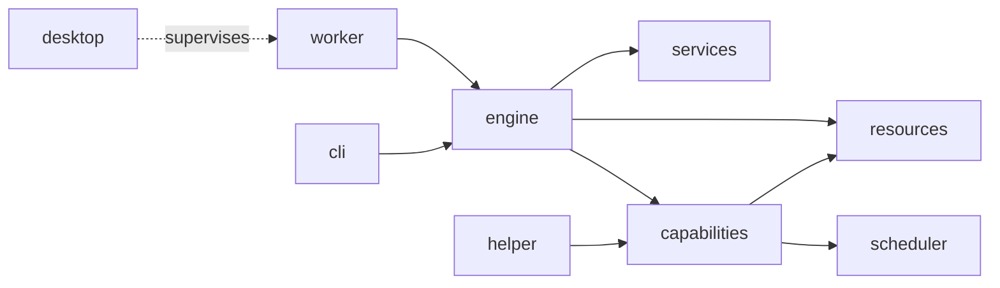

# Xylo documentation

Reference documentation for Xylo, written from the source. Each page lists what a module owns, its key types, limits, failure behavior, security notes and how to test it. Commands in the Testing sections are documented, not guaranteed to have been run.

## Start here

| Page                                          | Contents                                                             |
|-----------------------------------------------|----------------------------------------------------------------------|
| [Agents in Xylo](modules/engine-agents-and-skills.md)                   | Primary agent, helper agents, skills, plugin roles, permission modes |
| [Root README](../README.md)                   | Features, build from source, project layout                          |
| [SDK and headless sessions](../sdk/README.md) | `xylo-cli`, Rust SDK, telemetry, CI and releases                     |

## Module reference

| Layer                       | Pages                                                                                                                                                                                         |
|-----------------------------|-----------------------------------------------------------------------------------------------------------------------------------------------------------------------------------------------|
| **Contracts and state**     | [core](modules/core.md) · [services](modules/services.md) · [runtime](modules/runtime.md)                                                                                                     |
| **Agent engine**            | [engine](modules/engine.md) · [tools and permissions](modules/engine-tools.md) · [providers](modules/engine-providers.md) · [agents, skills and prompts](modules/engine-agents-and-skills.md) |
| **Native services**         | [capabilities](modules/capabilities.md) · [helper process](modules/helper.md) · [resources](modules/resources.md) · [scheduler](modules/scheduler.md)                                         |
| **Processes and frontends** | [worker](modules/worker.md) · [desktop](modules/desktop.md) · [cli](modules/cli.md)                                                                                                           |
| **Distribution**            | [updates and notifications](modules/distribution-and-notifications.md)                                                                                                                        |
| **Extending and testing**   | [SDK](modules/sdk.md) · [plugin SDK](modules/plugin-sdk.md) · [IDE bridge](modules/ide-vscode.md) · [evals](modules/evals.md)                                                                 |

## How the pieces fit

Solid arrows are crate dependencies; the dotted arrow is a process relationship. `core` (contracts) and `runtime` (host services) are used by most crates and are omitted.

## Conventions

- Pages cite source paths, not line numbers, so they survive edits.
- Limits and constants are copied from code. If code and a README disagree, these pages follow the code and note the difference.
- Each page ends with related pages. A "Gaps" note means that part was only skimmed.
